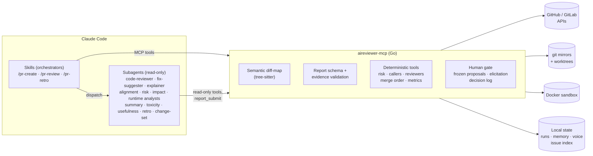
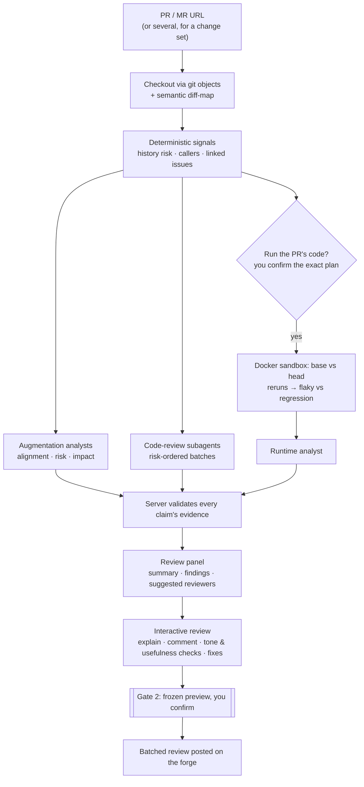
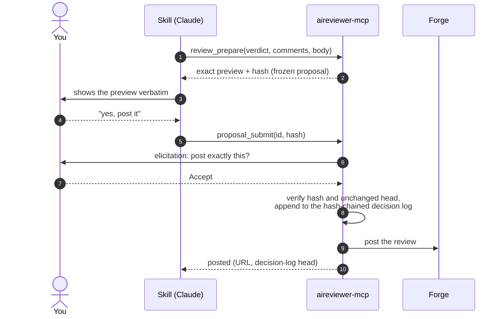
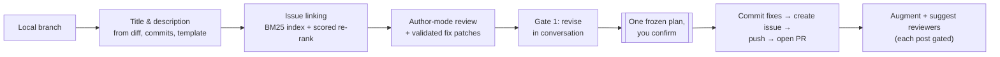

# aireviewer

**Agentic pull request / merge request creation and review for GitHub and GitLab**, packaged as a [Claude Code](https://docs.claude.com/en/docs/claude-code) plugin: orchestrator skills, specialised subagents, and a Go MCP server that does the deterministic work and enforces the human gates.

aireviewer implements the staged, human-in-the-loop framework proposed in

> **Rethinking Code Review in the Age of AI: A Vision for Agentic Code Review**<br>
> Hüseyin Özgür Kamalı, Erdem Tuna, Vahid Haratian, Eray Tüzün — [arXiv:2605.17548](https://arxiv.org/abs/2605.17548)

The paper splits code review into **PR creation**, **PR augmentation**, **reviewer selection**, **PR review** and **retrospective**. In every stage, agents prepare evidence and humans make the decisions. aireviewer turns that vision into working tools:

| Command | What it does |
|---|---|
| **`/pr-create [branch]`** | Generates the title and description (following your PR template). Links issues with relevance scores, or drafts a new one. Self-reviews the change and validates fix patches. You revise in conversation and approve one exact plan; only then does it commit, push and open the PR. Finally it augments the PR and suggests reviewers. |
| **`/pr-review <url> [url …]`** | Builds a semantic diff-map, then runs augmentation: alignment with linked issues, history-based risk, change impact, and (after you confirm) sandboxed runtime analysis. Parallel code-review agents add findings, each validated against the real code. You then get an interactive review session with explanations, comment drafting with tone and usefulness checks, and one-click fix suggestions. **Nothing is posted until you confirm the exact content.** Given several URLs, it reviews a cross-repository change as one: contracts, merge order, and changes that break each other. |
| **`/pr-retro <url>`** | Measures how a finished review went, summarises it with links, and keeps the lessons in local memory for future reviews. It also suggests configuration changes you can apply. |

> **Status: pre-alpha.** Everything below is implemented and covered by automated tests.
>
> - **Run live against sandbox repositories:** `/pr-review`, posting through the gate, `/pr-create`, the runtime sandbox and change sets.
> - **Not yet run against real services:** `/pr-retro`, the CI templates and the evaluation harness.
>
> The agent prompts have not been evaluated at scale; the [evaluation harness](evaluation/README.md) is how you measure them on your own PRs. See [CHANGELOG.md](CHANGELOG.md).

## Principles

- **Humans hold the gates.** Nothing is pushed, created, posted or executed without explicit confirmation of the exact content. The server enforces this itself (frozen proposals, MCP elicitation, a hash-chained decision log); a prompt alone would not be enforcement. The agent never chooses a review verdict.
- **Claims carry evidence.** Every finding cites code, a tool-computed metric, an execution log or an issue quote, and the server verifies each citation before accepting it. Confidence and contradictions are shown, not smoothed over.
- **Deterministic work goes to tools.** Diffs, risk scores, callers, merge order, test reruns and metrics come from code, not from a model.
- **Untrusted input stays data.** PR text, issues and code are never followed as instructions. Agents read code only through git objects, PR code runs only in a locked-down sandbox, and configuration comes from the merge base, so a PR cannot change how it is reviewed.
- **Forge-neutral core, forge-native voice.** "PR" is the internal term; on GitLab, users see "merge request" / "MR".

## How it works

### Architecture

Orchestrators run in the main Claude Code session as **skills**, because subagents cannot spawn subagents (ADR 0001). They dispatch read-only **subagents** and call the **MCP server**, which owns every side effect.



### Reviewing a PR



### The posting gate

Every forge write and every sandbox run goes through the same mechanism (ADRs 0003, 0006). The model can *prepare* a proposal but cannot change it afterwards, and cannot answer the confirmation for you.



### Creating a PR



## Capabilities

| Area | Highlights | Design |
|---|---|---|
| Semantic diff-map | Function/class-level units via tree-sitter, risk-ordered, highlighted diff views | SPEC §7, ADR 0004 |
| Evidence validation | Code, metric, trace and issue-quote citations checked by the server; per-agent submit tokens | SPEC §6, ADR 0005 |
| Augmentation | Alignment with issues, deterministic history risk (with bug labels), impact via references | SPEC §10 |
| Reviewer suggestion | CODEOWNERS + git expertise, workload, knowledge sharing (no LLM) | SPEC §11.1 |
| Gated posting | Frozen proposals, elicitation, circuit breaker, reviewer-first mode, decision log | ADR 0006 |
| PR creation | Branch runs, Gate 1 draft, one confirmed commit/issue/push/PR plan | ADR 0007 |
| Runtime analysis | Docker sandbox, base vs head, reruns and flaky detection, static analyzers | ADR 0008 |
| Reviewer voice | Personal and team voice for drafted comments; never changes what is claimed | ADR 0009 |
| Retrospectives | Deterministic review metrics, local memory, feedback suggestions | ADR 0010 |
| Headless CI | GitHub Actions and GitLab CI; posts only the opted-in summary | ADR 0011 |
| Evaluation | Golden cases, precision/recall by category, cost tracking, regression checks | ADR 0012 |
| Issue index | Local BM25 (SQLite FTS5), incremental sync | ADR 0013 |
| Change sets | Several PRs across repos and forges: cross-PR contracts, merge order, conflicts | ADR 0014 |

## Quick start

Requirements: Go 1.26+ with a C toolchain (cgo, for tree-sitter), git ≥ 2.31, [Claude Code](https://docs.claude.com/en/docs/claude-code), and optionally `gh` for GitHub authentication and Docker for runtime analysis.

```bash
git clone https://github.com/husobee/aireviewer && cd aireviewer
make build                       # builds bin/aireviewer-mcp
./bin/aireviewer-mcp augment https://github.com/cli/cli/pull/15065   # quick check, no model calls
claude --plugin-dir .            # load the plugin from this checkout
```

Then, inside Claude Code:

```text
/aireviewer:pr-review https://github.com/OWNER/REPO/pull/123
/aireviewer:pr-review https://github.com/o/api/pull/5 https://gitlab.com/g/client/-/merge_requests/9
/aireviewer:pr-create            # from a feature branch of a repository you own
/aireviewer:pr-retro https://github.com/OWNER/REPO/pull/120
```

Configure a repository with `.aireviewer.yml` on its default branch: policies, runtime sandbox, comment checks, voice, memory, CI. See [examples/.aireviewer.yml](examples/.aireviewer.yml).

### Authentication

| Forge | Resolution order |
|---|---|
| GitHub / GHES | `GITHUB_TOKEN`, `GH_TOKEN`, then `gh auth token --hostname <host>` |
| GitLab / self-managed | `GITLAB_TOKEN`, then `CI_JOB_TOKEN` (in CI, for the job's own instance only) |

Public projects work unauthenticated, subject to rate limits. Tokens are only sent to `github.com`, `gitlab.com` and self-hosted hosts you declare. URLs on any other host are refused:

```bash
export AIREVIEWER_GITLAB_HOSTS=code.example.com
export AIREVIEWER_GITHUB_HOSTS=ghe.example.com
```

The exact fine-grained token permissions each feature needs are listed in [docs/forge-tokens.md](docs/forge-tokens.md).

### Where things are stored

| What | Where |
|---|---|
| Run artifacts (diff-maps, validated reports, decision log) | `.aireviewer/` in the directory you run Claude Code from (it ignores itself) |
| Git mirrors, PR worktrees, issue index | `$AIREVIEWER_CACHE_DIR` (default `~/.cache/aireviewer`) |
| Your reviewer voice | `$AIREVIEWER_CONFIG_DIR` (default `~/.config/aireviewer`) |
| Retrospective memory | `$AIREVIEWER_DATA_DIR` (default `~/.local/share/aireviewer`) |

## Repository layout

```
cmd/aireviewer-mcp/   MCP server (stdio) + CLI: inspect, diffmap, augment, evaluate
internal/
  forge/              forge-neutral model + GitHub and GitLab adapters
  gitrepo/            cached mirrors, worktrees, author-repo operations
  diffmap/            semantic diff-map (tree-sitter)
  schema/             report schema + evidence validation
  mcpserver/          MCP tools: review, gates, creation, runtime, retro, change sets
  history/ reviewers/ risk scoring, expertise, reviewer suggestion
  sandbox/            Docker runner, test-result classification, analyzer parsing
  changeset/          cross-PR merge order and compatibility
  retro/ memory/      review metrics, local memory, feedback suggestions
  issueindex/         BM25 issue index (SQLite FTS5)
  golden/             evaluation scoring and runner
  voice/ config/ decisionlog/ runctx/ providers/
skills/               orchestrator skills (/pr-create, /pr-review, /pr-retro)
agents/               subagent prompts
ci/                   headless CI image and templates
evaluation/           golden cases and the evaluation guide
docs/adr/             architecture decision records
```

## Documentation

- **[SPEC.md](SPEC.md):** the full design, mapped section by section to the paper, with milestones and deliberate deviations (§18).
- **[docs/adr/](docs/adr/):** 14 architecture decision records, from orchestrators-as-skills to change sets.
- **[ci/README.md](ci/README.md):** headless CI setup.
- **[evaluation/README.md](evaluation/README.md):** measuring review quality on your own PRs.
- **[SECURITY.md](SECURITY.md):** threat model and how to report vulnerabilities.

## Roadmap: future additions

- **Change sets, later slices** (SPEC §21): `/pr-create` across several branches or repositories with a declared merge order; building and testing a set together in the sandbox; a combined diff-map.
- **External issue trackers: Jira** (SPEC §22), for alignment and issue linking beyond forge issues.
- **Embeddings** for the issue index, merged with BM25 once a provider is chosen.
- **Validation at scale:** a public golden set and evaluation baselines, and CI templates exercised on real pipelines.

## Contributing

Contributions are welcome: read [CONTRIBUTING.md](CONTRIBUTING.md). Commits must be signed off under the [DCO](https://developercertificate.org/). Please report security issues privately as described in [SECURITY.md](SECURITY.md).

## Citation

If you use aireviewer in research, please cite both the software ([CITATION.cff](CITATION.cff)) and the paper it implements:

```bibtex
@misc{kamali2026agenticcodereview,
  title         = {Rethinking Code Review in the Age of AI: A Vision for Agentic Code Review},
  author        = {Kamal{\i}, H{\"u}seyin {\"O}zg{\"u}r and Tuna, Erdem and Haratian, Vahid and T{\"u}z{\"u}n, Eray},
  year          = {2026},
  eprint        = {2605.17548},
  archivePrefix = {arXiv}
}
```

## License

[MIT](LICENSE). aireviewer is an independent implementation and is not affiliated with the paper's authors.
